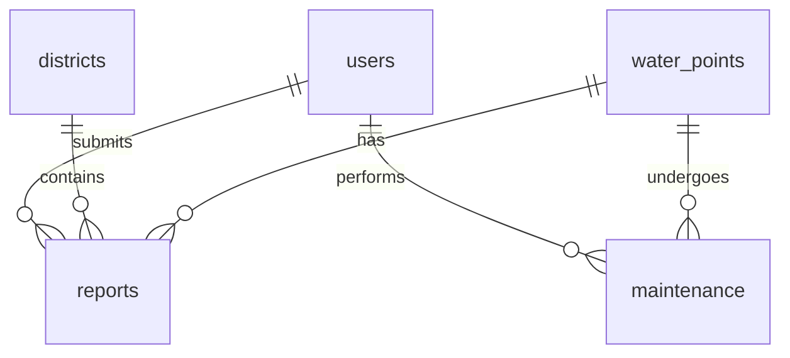

# Maji-Track Database Schema

## Entity-Relationship Diagram (ERD)



## Tables

```sql
CREATE TABLE users (
    id SERIAL PRIMARY KEY,
    username VARCHAR(50) UNIQUE NOT NULL,
    email VARCHAR(100) UNIQUE NOT NULL,
    password_hash VARCHAR(255) NOT NULL,
    role VARCHAR(20) DEFAULT 'citizen',
    created_at TIMESTAMP DEFAULT CURRENT_TIMESTAMP
);

CREATE TABLE districts (
    id SERIAL PRIMARY KEY,
    name VARCHAR(100) UNIQUE NOT NULL
);

CREATE TABLE water_points (
    id SERIAL PRIMARY KEY,
    name VARCHAR(100) NOT NULL,
    type VARCHAR(50) NOT NULL,
    latitude DECIMAL(9, 6) NOT NULL,
    longitude DECIMAL(9, 6) NOT NULL,
    region VARCHAR(100) NOT NULL,
    status VARCHAR(20) DEFAULT 'functional',
    created_at TIMESTAMP DEFAULT CURRENT_TIMESTAMP
);

-- Matches what the frontend submits from the "Report a Water Shortage" form.
CREATE TABLE reports (
    id SERIAL PRIMARY KEY,
    district_id INT REFERENCES districts(id) ON DELETE SET NULL,
    water_point_id INT REFERENCES water_points(id) ON DELETE CASCADE,
    user_id INT REFERENCES users(id) ON DELETE SET NULL,
    location VARCHAR(150) NOT NULL,
    severity VARCHAR(20) NOT NULL,          -- Critical | High | Moderate | Low
    time_without_water VARCHAR(50) NOT NULL, -- e.g. '3 weeks'
    issue_description TEXT NOT NULL,
    image_url TEXT,
    status VARCHAR(20) DEFAULT 'pending',    -- pending | approved | rejected
    reported_at TIMESTAMP DEFAULT CURRENT_TIMESTAMP
);

CREATE TABLE maintenance (
    id SERIAL PRIMARY KEY,
    water_point_id INT REFERENCES water_points(id) ON DELETE CASCADE,
    technician_id INT REFERENCES users(id) ON DELETE SET NULL,
    action_taken TEXT NOT NULL,
    cost DECIMAL(10, 2),
    maintenance_date TIMESTAMP DEFAULT CURRENT_TIMESTAMP
);
```
